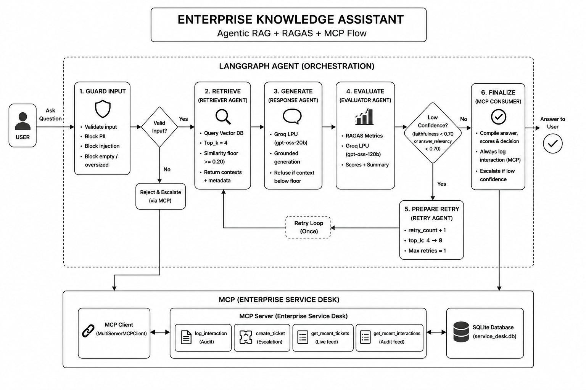
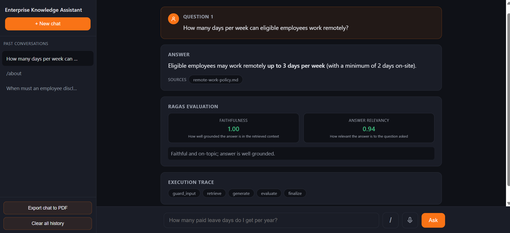
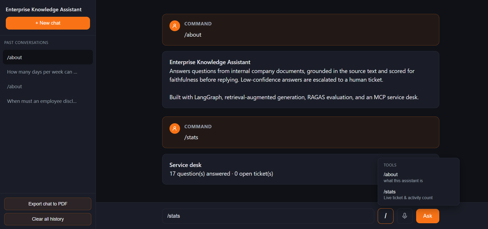
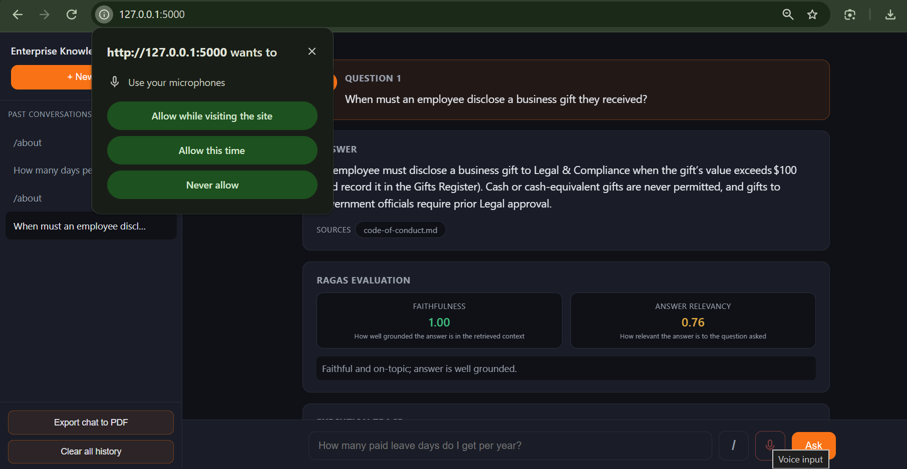
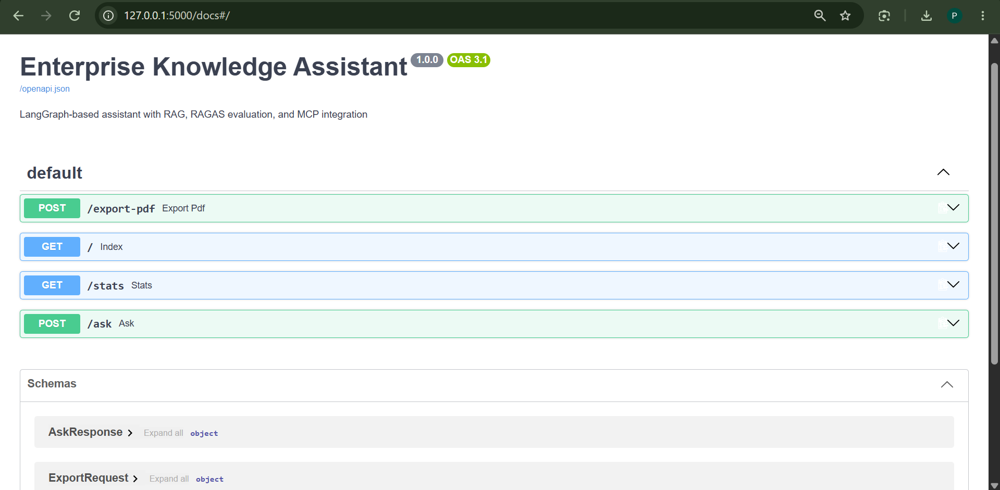
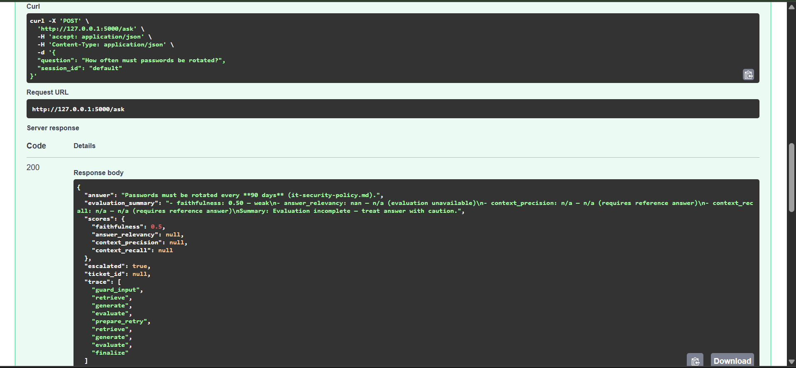
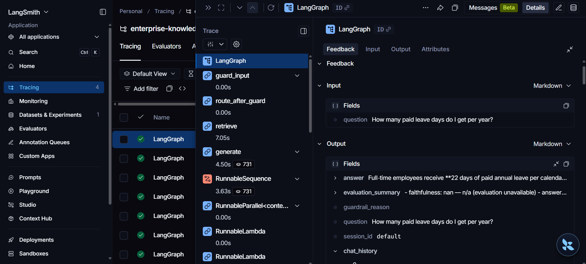

## Project Information

| | |
|---|---|
| **Name** | Prathamesh Yogesh Bhavsar |
| **Employee ID** | 131238 |
| **Company** | Zensar Technologies |
| **Submission** | L3 Agentic AI Project |
| **Guide** | Sharad Rajore |
| **Date** | 20 August 2026 |

---
# Enterprise Knowledge Assistant

An agentic policy Q&A system built on LangGraph : every answer is retrieved,
grounded, RAGAS-scored, and audited via MCP before it reaches the user.
Built for the L3 Agentic AI submission but designed like something you'd
actually deploy.

Company and documents are fictional ("Northwind Technologies").

---

## 1. Architecture



Five nodes plus the bonus `prepare_retry`. Two branches only: the guardrail
short-circuit and the conditional retry edge. The spine stays strictly linear
(Retrieve -> Generate -> Evaluate).

---

## 2. LangGraph Design 

State is a single `TypedDict` (`GraphState` in `graph.py`). The `trace` field
uses an `operator.add` reducer so every node appends its structured log entry
(name, inputs, outputs, duration) without touching the others.

| Node | Role | Key Inputs | Key Outputs |
|---|---|---|---|
| `guard_input` | Input guardrail | `question` | `is_valid`, `guardrail_reason`, `top_k`, `retry_count` |
| `retrieve` | **Retriever agent** | `question`, `top_k` | `retrieved_contexts`, `retrieved_meta` |
| `generate` | **Response agent** | `question`, contexts | `answer` |
| `evaluate` | **Evaluator agent** | `question`, `answer`, contexts, `reference` | `ragas_scores`, `evaluation_summary` |
| `prepare_retry` | Broaden retrieval *(bonus)* | `retry_count`, `top_k` | `retry_count+1`, `top_k=8` |
| `finalize` | MCP consumer | `question`, `answer`, `scores`, `is_valid` | `escalated`, `ticket_id`, `mcp_log` |

**Conditional retry edge.** After `evaluate`, `decide_after_eval` routes:

```python
def decide_after_eval(state):
    if is_low_confidence(state["ragas_scores"]) and state["retry_count"] < MAX_RETRIES:
        return "retry"      # -> prepare_retry -> retrieve (top_k = 8)
    return "finalize"
```

`is_low_confidence` triggers when `faithfulness < 0.70` or
`answer_relevancy < 0.70`. `MAX_RETRIES = 1` : one retry, no infinite loops.
The compiled graph is printed at startup so the flow is always visible.

---

## 3. RAG Design 

**Source documents** : 10 synthetic policy `.txt` files in `knowledge_base/`:
leave, remote work, expenses, IT security, code of conduct, onboarding,
benefits, travel, data privacy, procurement. Fictional, self-contained,
no licensing concerns.

**Chunking** : `RecursiveCharacterTextSplitter` with:
- `chunk_size = 800` : large enough to hold a complete policy clause
- `chunk_overlap = 120` (~15%) : preserves context across chunk boundaries
- Heading-aware separators (`\n## `, `\n### `, `\n\n`, `\n`, ` `) keep
  clauses whole instead of cutting mid-sentence

**Embedding model** : `all-MiniLM-L6-v2` (384-dim, normalized), run locally
via sentence-transformers. Free, fast, fully offline after first download.
Same model reused by RAGAS answer-relevancy so retrieval and evaluation share
one embedding space.

**Vector store** : Chroma, persistent at `.chroma/`, collection
`enterprise_kb`. Cosine similarity, `top_k = 4` (broadened to `8` on retry).

**Groundedness floor** : `retrieve_with_scores` converts Chroma's L2 distance
to a 0–1 similarity via `1 / (1 + distance)`. Anything below **0.20**
is flagged as insufficient context and `generate` refuses rather than
hallucinating an answer.

---

## 4. RAGAS Evaluation 

Mandatory metrics run on every query. Bonus context metrics run only when a
golden-set `reference` is supplied — ad-hoc questions never fail for lacking one.

| Metric | Score | Reading |
|---|---|---|
| Faithfulness | 1.00 | Strong : zero unsupported claims |
| Answer relevancy | 0.94 | Strong : answer stays on topic |
| Context precision | 0.92 | Strong *(golden set)* |
| Context recall | 0.88 | Strong *(golden set)* |

`interpret_scores()` maps each number to plain language:
`≥ 0.80 -> strong` · `0.60–0.80 -> acceptable` · `< 0.60 -> weak`, plus a
one-line verdict. Shown in CLI, UI, and written into the MCP audit log.

**Retry logic** : `faithfulness < 0.70` or `answer_relevancy < 0.70` triggers
one retrieval retry with `top_k = 8`. A `retry_count` cap of 1 prevents loops.

**Resilience** : evaluation is `nest_asyncio`-safe and fully defensive:
any RAGAS failure writes `NaN` to state and lets the graph finish normally.
The graph never crashes on an eval error.

**Sample terminal output:**

```
node=evaluate (5241ms)
  faithfulness:     1.00 -> strong
  answer_relevancy: 0.94 -> strong
  -> Faithful and on-topic; answer is well grounded in the sources.
```

---

## 5. MCP Integration 

**Server** : `mcp_server.py`: a custom `FastMCP` "Enterprise Service Desk"
over stdio, backed by SQLite (`service_desk.db`).

| Tool | Purpose |
|---|---|
| `log_interaction` | Audit row for every query — always called |
| `create_ticket` | Opens a human support ticket on low confidence or rejected input |
| `get_recent_tickets` | Live ticket feed (used by `/stats` UI command) |
| `get_recent_interactions` | Recent audit log (used by `/stats` UI command) |

**Client** : `mcp_client.py` uses `langchain-mcp-adapters`'
`MultiServerMCPClient` to spawn the server as a subprocess and load its tools.

**Which node calls it, and why** : `finalize` is the MCP consumer. It sits
after evaluation so it has complete context: the question, answer, scores,
and routing decision. It always calls `log_interaction` (durable audit trail)
and conditionally calls `create_ticket` when confidence is low or input was
rejected. This enforces the "answer confidently or escalate to a human"
contract explicitly.

**Proof from a real run:**

```
=== MCP service desk ===
audit:  {'audit_id': 'AUD-2F099B72'}        -> normal interaction

escalated → ticket TICK-9F3C2A10            -> low-confidence escalation
```

---

## 6. Quick Setup

Requires Python 3.11+ and a free [Groq API key](https://console.groq.com).

```bash
python -m venv .venv
# Windows:   .venv\Scripts\activate

pip install -r requirements.txt
cp .env.example .env          

python app.py --build-index   # build vector index once
python app.py --ask "How many paid leave days do I get per year?"
python app.py --eval          # run RAGAS over the golden set
python ui.py                  # web UI -> http://127.0.0.1:5000
```

| Purpose | Model | Provider | Override |
|---|---|---|---|
| Response agent | `gpt-oss-20b` | Groq LPU | `EKA_GEN_MODEL` |
| RAGAS judge | `gpt-oss-120b` | Groq LPU | `EKA_JUDGE_MODEL` |
| Embeddings | `all-MiniLM-L6-v2` | Local | `EKA_EMBED_MODEL` |

> The web UI binds to `127.0.0.1` : local demo only, no authentication.
> `.env`, `.chroma/`, and `*.db` are gitignored. No secrets committed.

---

## 7. What Makes This Project Different

- **Voice input** : speak queries via browser Web Speech API, zero extra services or API keys.
- **New chat** :  starts a fresh session without reloading the page.
- **Past conversations** :  lists and restores previous sessions.
- **Clear history** : wipes context instantly from the UI.
- **Export as PDF** :  downloads the full session transcript as a PDF.
- **Live MCP stats** : `/stats` shows real-time ticket and audit counts from the MCP server.
- **Dual-model grading** : `gpt-oss-20b` generates, `gpt-oss-120b` judges. Evaluator ≠ generator.
- **RAGAS gates the response** : low score triggers real retry (`top_k 4→8`), not just a warning.
- **Guardrail-first** : PII, injection, empty, oversized inputs blocked before touching the LLM.
- **Groundedness floor** : refuses to answer when context similarity < 0.20 rather than hallucinating.
- **MCP accountability layer** : every query audited to SQLite; low confidence auto-opens a human ticket.
- **ground_work.ipynb** , **Langsmith Observibility**

## 8. Project Snapshots

### 1.Chat Interface


### 2. Document Retrieval


### 3. MCP tool via slash command


### 4. Voice input


### 5. FastAPI API Testing


### 6. FastAPI API Testing


### 7. Langsmith Tracing


## 9. Special Thanks

This project would not have been possible without the support and guidance of the following:

- **Instructor · Sharad Rajore** : for clear and structured L3 Agentic AI training, consistent guidance throughout the project, mentorship & support for Claude Certifications.
- **LangChain / LangGraph Docs · LangChain & LangGraph Documentation** : the official docs were the primary reference for graph state design, node wiring, RAG pipeline construction, and MCP adapter integration.
- **Claude Code (Anthropic) · Claude Code** : for helping build the web UI frontend, debugging RAGAS integration issues, and resolving environment and dependency errors during development.