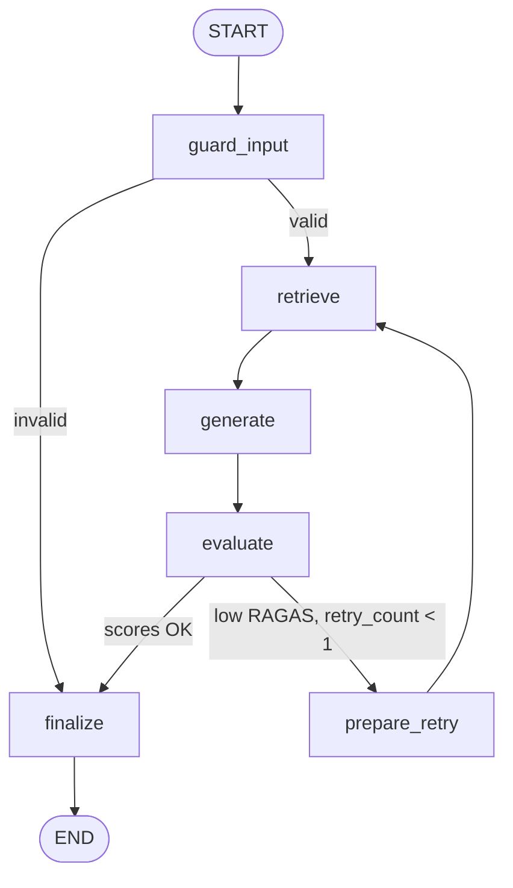

# Architecture

## Overview

The Enterprise Knowledge Assistant is a LangGraph `StateGraph` that answers
enterprise policy questions from a governed knowledge base, scores each answer
with RAGAS, and uses a custom MCP server as the enterprise system-of-record
(audit log + human ticketing).

## Graph flow

The core rubric spine is `retrieve → generate → evaluate` (the three required
agents). `guard_input` and `finalize` are the guardrail-innovation and MCP
layers; `prepare_retry` + the `decide_after_eval` edge are the bonus conditional
retry.

## Components

- **State** (`src/eka/graph/state.py`) — one shared `TypedDict`; `trace` uses an
  `operator.add` reducer so nodes append log entries without clobbering.
- **Nodes** (`src/eka/graph/nodes.py`) — each wrapped by `@log_node` for
  structured observability.
- **Edges** (`src/eka/graph/edges.py`) — `route_after_guard`, `decide_after_eval`.
- **Build** (`src/eka/graph/build.py`) — wires nodes/edges and compiles.
- **RAG** (`src/eka/rag/`) — `loader`, `splitter`, `vectorstore`, `retriever`.
- **Evaluation** (`src/eka/evaluation/ragas_eval.py`) — RAGAS runner +
  `interpret_scores`.
- **MCP** (`mcp_server/server.py` + `src/eka/mcp/client.py`) — FastMCP server over
  stdio/SQLite and the adapter client used by `finalize`.
- **Guardrails** (`src/eka/guardrails/guards.py`) — input validation and
  groundedness/relevance-floor check.
- **Observability** (`src/eka/observability/logging.py`) — `@log_node` + optional
  LangSmith env tracing.

## Data flow for one query

1. `guard_input` validates the question and initializes `top_k`, `retry_count`.
2. `retrieve` embeds the query and pulls the top-k chunks from Chroma.
3. `generate` answers strictly from the retrieved context (or refuses if the
   context is below the relevance floor).
4. `evaluate` runs RAGAS (Claude judge + local embeddings) and interprets scores.
5. `decide_after_eval` optionally routes back through `prepare_retry → retrieve`
   once when scores are low.
6. `finalize` logs the interaction via MCP and escalates a ticket when the query
   was rejected or stayed low-confidence.

## Key decisions

- **Anthropic Claude** for generation and the RAGAS judge; **local HF
  embeddings** because Anthropic has no embeddings API — one cloud key total.
- **Linear flow, no supervisor** — matches the assignment's guidance and keeps
  the graph readable; the only branch is the bonus retry edge.
- **Defensive evaluation and MCP calls** — never crash the graph; a failure is
  recorded in state and the user still gets an answer.
